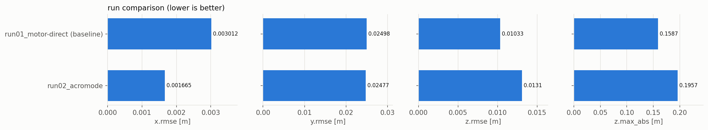

# Run comparison

Generated 2026-10-25 17:16 by pa.py compare. Errors: lower is better. Δ is the change against the baseline run.

| Run | What changed | x.rmse [m] | y.rmse [m] | z.rmse [m] | z.max_abs [m] | z.settled_at [s] | Δ x.rmse vs baseline | Verdict | Plots |
|---|---|---|---|---|---|---|---|---|---|
| 2026-10-25_run01_motor-direct (baseline) | old pipeline: sim_node sets 4 motors from /motor_cmd (acro_mode:=false) | 0.003012 | 0.02498 | 0.01033 | 0.1587 | 0.89 | - | baseline: steady 1.4 mm/axis; start transient 0.37 m (y), 0.16 m z overshoot | [plots](runs/2026-10-25_run01_motor-direct/plots) |
| 2026-10-25_run02_acromode | AcroMode: converter -> TRPYCommand -> AcroMode rate loop (kw 20/35/45, J from model) | 0.001665 | 0.02477 | 0.0131 | 0.1957 | 0.89 | -44.7 % | same steady state as baseline; z startup overshoot +23 % (0.196 vs 0.159 m) | [plots](runs/2026-10-25_run02_acromode/plots) |

